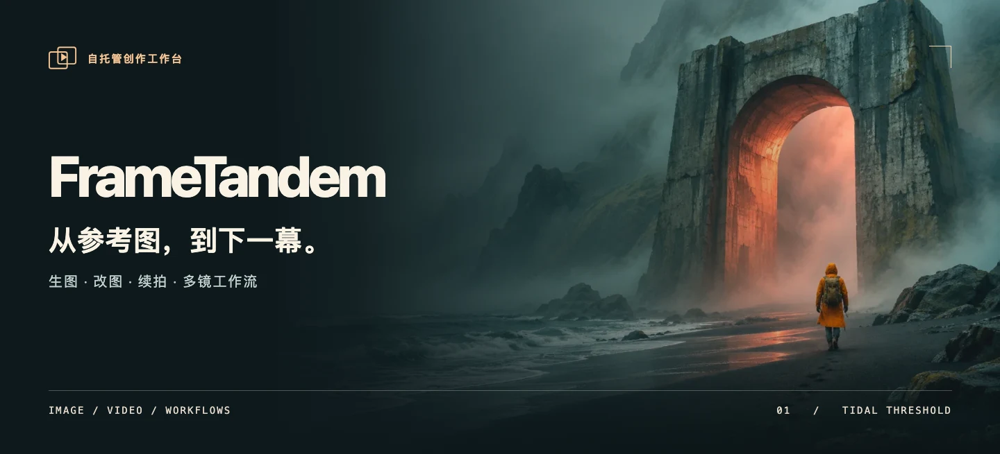
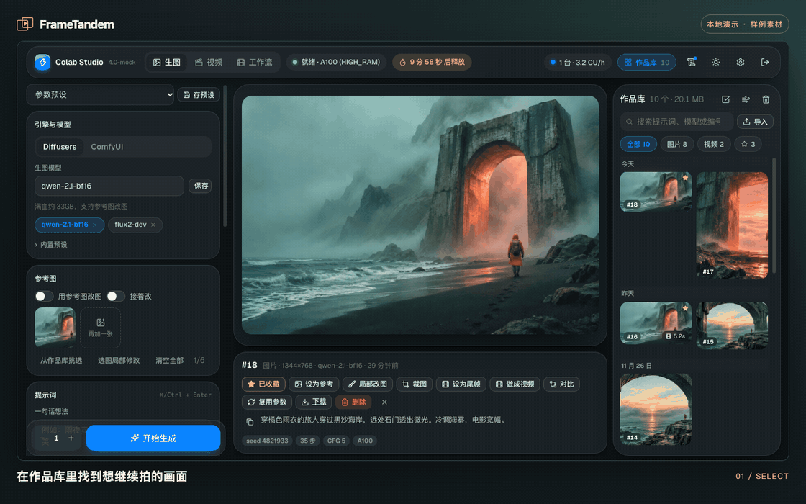
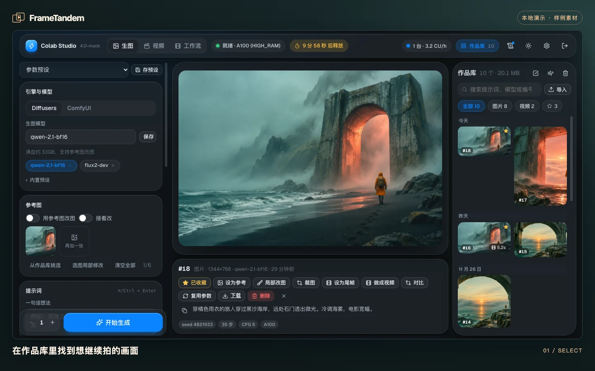
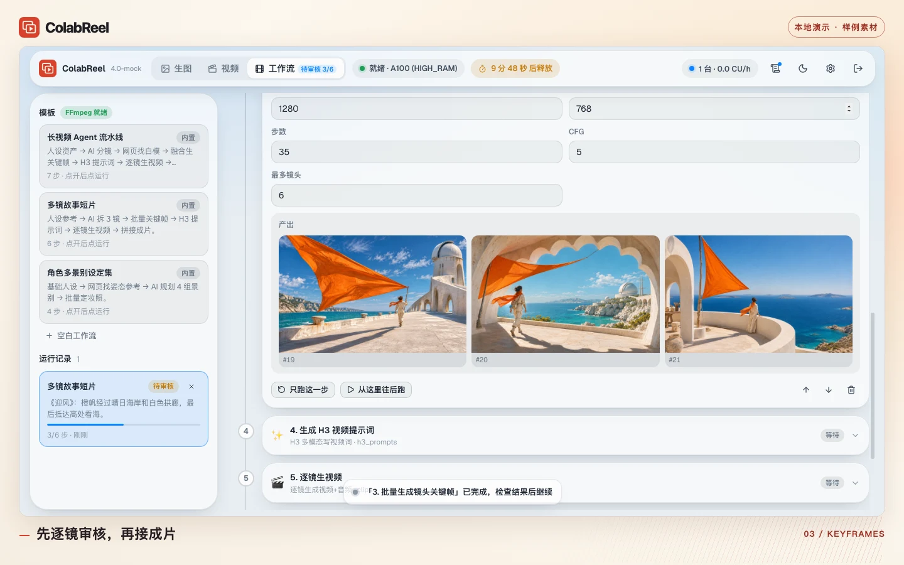
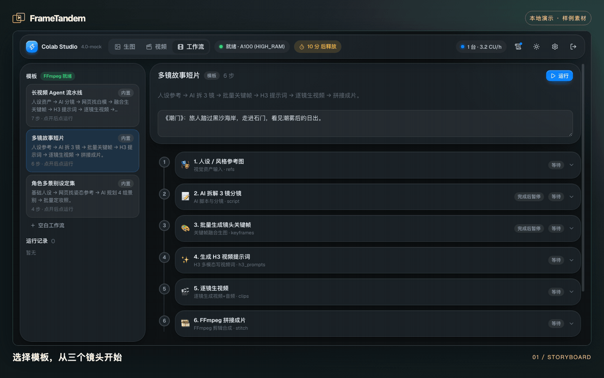

# ColabReel

**From Colab to the next shot.**

ColabReel 是可自托管的开源图像与视频创作工作台。可以从一句提示词或一张参考图开始，在作品库里继续修改、取帧和续拍，再把多个镜头接成一段视频。工作台部署在你自己的电脑或服务器上，生成任务交给 Google Colab 的 GPU。



[看宣传片](docs/media/launch.mp4) · [快速开始](#快速开始) · [创作指南](docs/guide.md) · [部署与运维](docs/deployment.md) · [版本发布](https://github.com/M1nt-Ch0c0/colab-playground/releases)

## 在工作台里做什么

- **把一张图改到满意。** 从提示词生成初稿，拖入参考图继续改；只需要调整一处时，用画笔圈出选区。
- **把已有镜头变成下一段。** 用首尾帧控制画面，用片尾续拍，或者把白模片段的动作和运镜作为参考，配上自己的人设图。
- **把长任务拆成镜头。** 用工作流逐镜生成，在审核点挑选中间结果，再拼接成片。素材、生成参数和成品都能在作品库找回。



[高清 MP4](docs/media/workbench-demo.mp4)

<details>
<summary>查看界面截图和分镜审核演示</summary>







[高清 MP4](docs/media/workflows-demo.mp4)

</details>

界面录自本地演示，使用样例素材，未连接 Colab GPU。

## 快速开始

准备好 **Docker Compose**，以及一个能申请 Colab GPU 的 Google 账号。下载项目后，在项目目录创建配置：

```bash
git clone https://github.com/M1nt-Ch0c0/colab-playground.git
cd colab-playground
mkdir -p data
cp -n secret.env.example data/secret.env
chmod 600 data/secret.env
```

编辑 `data/secret.env`，将 `password` 和 `token` 替换成各自独立的强随机值，然后启动：

```bash
docker compose up -d --build
```

打开 [http://127.0.0.1:8787](http://127.0.0.1:8787)，登录后在「设置 → Google Colab」完成授权。第一次可以先生成一张图，再从作品库选中它，试试「设为参考」。已有素材也可以直接导入。遇到数据目录权限问题，见[部署与运维](docs/deployment.md#docker-与数据目录)。

Colab GPU 的可用性、配额和费用由你的账号和套餐决定，不保证随时可用。不同模型的显存需求不同。ColabReel 是独立项目，与 Google Colab 无隶属关系。

## 文档与贡献

- [创作指南](docs/guide.md)：改图、视频参考、续拍与工作流。
- [部署与运维](docs/deployment.md)：不使用 Docker 的安装、配置、备份与自动发布。
- [贡献指南](CONTRIBUTING.md) · [后端设计](docs/backend-redesign.md) · [HTTP API](docs/API.md)

欢迎通过 [Issues](https://github.com/M1nt-Ch0c0/colab-playground/issues) 报告问题或提出建议。按 [MIT License](LICENSE) 开源；外部模型和服务适用各自的许可与条款。
