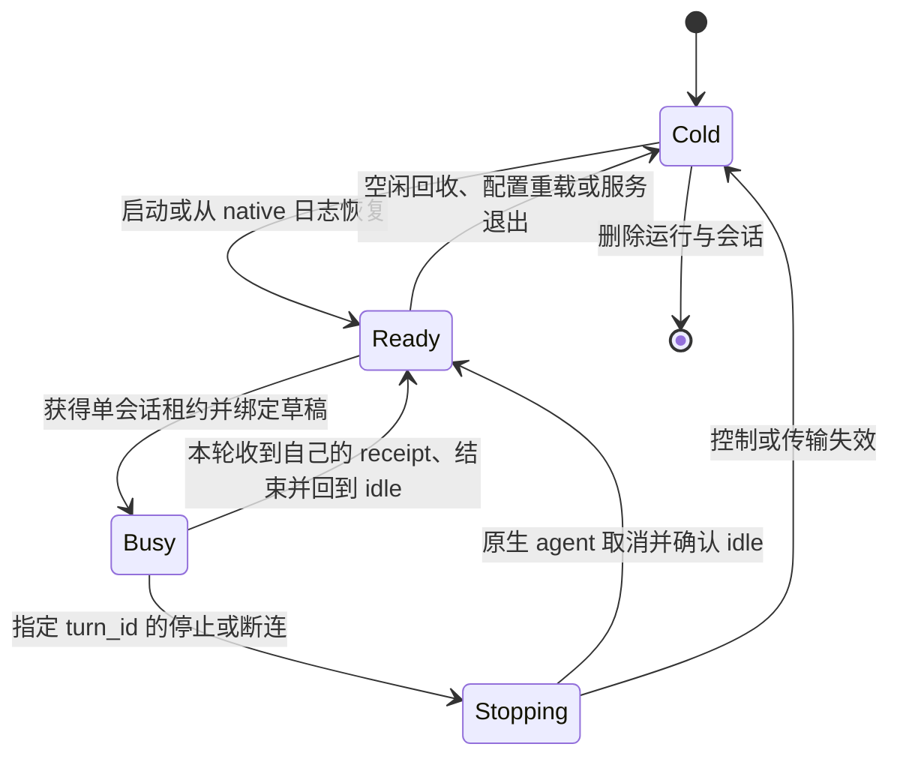
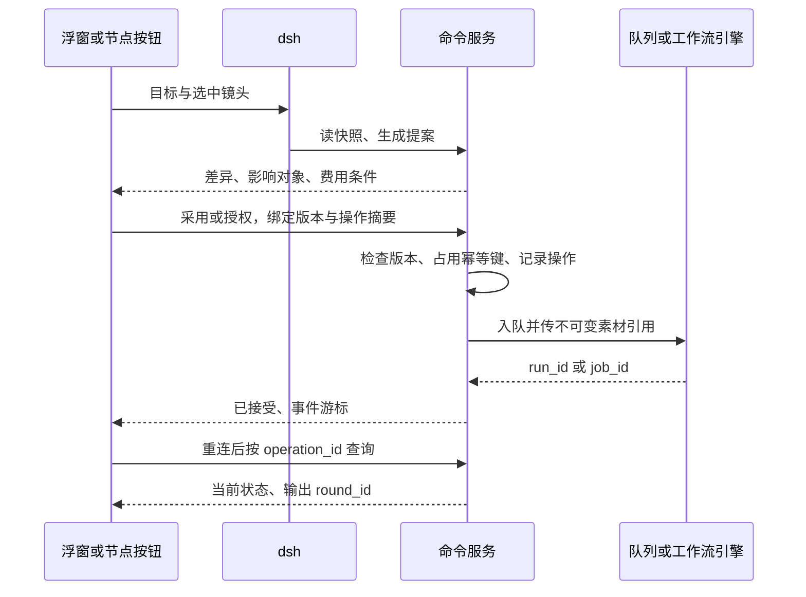

# dsh 嵌入 Studio 详细设计

本文使用两个钉住的修订。业务事实取自 `origin/main@61ccfcd`，可运行原型取自 `codex/workflow-harness-wip@16ae892`。下文用“现有”说明可在相应修订复核的行为，用“目标”标出要评审的接口、数据结构和演进安排。[总体设计](./overview.md) · [工具逐项契约及主干路由对照](./tool-catalog.md)

## 1. 模块与调用方向

| 所有者 | 现有入口与职责 | 目标适配点 |
|---|---|---|
| Web 编辑器 | `Workflow.tsx` 管理模板预览和运行草稿，`WorkflowAgent.tsx` 消费 NDJSON、提交已验证的编辑。主干 `MediaEditor.tsx` 持有裁框、笔刷与播放头。 | `EditorContext` 从当前选择生成对象 ID 与版本。按钮和浮窗共用提案面板、候选字段写回及任务详情。 |
| FastAPI | 主干按 generation、library、workflows、llm、proxies 分组，`HttpBoundary` 验证登录和请求体。 | Agent 适配器拿到已认证上下文后调用同进程应用服务。耗时动作交给现有队列或持久操作执行器。 |
| dsh 会话 | 分支 `copilot.py` 管理进程、native session、桥接与事件，`agent_plugins.py` 管理 Studio 专用 profile。 | 会话键和用户/项目授权分离。记录 profile 指纹、包版本、恢复原因和资源占用。 |
| 工具执行 | `dsh_tools.mjs` 注册结构化工具，`ToolBridge` 在回环地址认证进程，`EditorTools` 每轮处理当前快照。 | Domain registry 维护 schema 和执行函数。先校验作用域、版本及授权，再派发到 owner，统一投影结果。 |
| 工作流和生成 | `WorkflowEngine` 顺序执行及保存节点产出。`Studio` 管理生成、冻结引用、队列与 GPU。 | 分镜写回、幂等提交和运行日志延用各层的锁。Agent 不能仅凭某一轮文本回答改变任务状态。 |
| 素材、模型和线路 | `Store` 保存媒体、缩略图、元数据及回收站。`Providers` 采用 SQLite，代理服务维护脱敏配置。 | 文件由服务端解析为媒体句柄，模型只看到与意图相关的字段。SecretStr、Cookie 和代理认证信息在宿主边界内处理。 |

## 2. 数据对象、主键与事实来源

| 对象 | 主键与内容 | 持久化/兼容策略 |
|---|---|---|
| Project、Draft | 目标 `project_id/draft_id/revision`，保存图、生成表单、变量、资源引用。每次提交也保存变更作者与字段。 | 首期可用已保存的 run 作为一个工作空间。保留旧 `wf_*` 模板 ID、`wr_*` 运行 ID 和旧 API。旧模板首次修改时补缺省字段。 |
| Node、Binding | 节点键使用 `step.id`。边保存目标端口、来源节点、产物类型、多值顺序。坐标属于布局。 | 当前执行依据 steps 顺序及 config 的 `*_from`、`ref_sources`、`extra_ref_sources`。把新图投影回同一份定义，避免双写两套拓扑。在主干修订上另含 `video_from`。 |
| Variable | 目标区分项目值、镜头覆盖和系统运行值，记录类型、默认值和引用位置。 | 原型实现工作流级 `{{vars.look}}` 等标量值。已有 `{{topic}}`、`{{scene.keyframe_prompt}}` 和步骤输出模板继续按引擎规则解析。未知引用应在预检中提示，变量声明与展开时的值分别保留。 |
| Shot、Output | 目标 `shot_id`、`output_revision`、上游原件版本、生成批次。当前分镜脚本用 `scenes[].index`，下游常用 `items[].scene_index`。 | 为旧输出分配并持久化稳定 shot_id 和来源，兼容读取索引。重新分镜产生新一代输出，不能让旧提案写到同序号的新镜头。 |
| Asset、Reference | `round_id` 保留前导零，运行上传使用 `run_id + filename`。目标 resource handle 带媒体种类、作用域和版本。 | 上传暂存、作品、共享参考槽是三种不同所有者。工具接收已解析的句柄，任务入队时冻结实际输入和顺序。 |
| Conversation、Turn | 原型保存运行使用 `run_id`，未保存模板使用 `wr_ + draft_id`，与将来建 run 的 request_id 对应。每轮另有 `turn_id`。 | native 记录保留模型与工具历史。`recent.json` 是最近 24 条成功交流的界面投影，只供显示。旧客户端发送的 history 仅在新 native 会话导入一次。无身份的旧临时草稿按单轮方式兼容。 |
| Proposal、Operation、Job | 目标 `proposal_id` 是待采用差异，`operation_id` 是用户授权的尝试，`job_id/run_id` 是执行器实际签发的身份。 | 结果和状态单独持久化。聊天里“已建议”、队列“已接受”、实际“已完成”三种记录各有明确消息来源。 |

### 持久层最小结构（目标）

| 集合 / 唯一键 | 必要字段与事务责任 |
|---|---|
| `drafts(project_id, draft_id)` | revision、schema_version、body、updated_at。使用条件更新递增 revision。元数据小事务提交后再通知浏览器。 |
| `shots(draft_id, shot_id, generation)` | 上游节点、旧 index、当前字段与 field_versions。维持镜头顺序索引，保留重新分镜前的来源关系。 |
| `proposals(proposal_id)` | scope、readset、writeset、候选稿、创建人、到期时间、采用状态。一个 proposal 只能有一个成功采用结果。 |
| `operations(principal, scope_id, tool, idempotency_key)` | 唯一键绑定 spec_hash，持久化 state、approval_id、executor_ids、result 和错误。不在数据库事务中等待模型或 GPU。 |
| `operation_items(operation_id, shot_id, generation)` | 批处理子项、冻结资源句柄与单项结果。后台工作者按可恢复的状态机领取及回填。 |
| `events(scope_id, seq)` | seq 在作用域内单调递增，另存 operation_id、actor、entity_ref 和 payload 摘要。成功写入与对应事件使用同一事务或 outbox。 |
| `approvals(approval_id)` | principal、scope、action_digest、policy_version、expires_at 和 consumed_by。对授权消费及幂等绑定加唯一约束。 |
| `tool_telemetry(turn_id, call_seq)` | 本地脱敏统计：model、tool、op、ok、error_code、retry_in_turn、latency_ms、cache_hit_tokens、cache_miss_tokens、proposal_outcome（采用/拒绝/撤销）。不记录密钥、Cookie 与媒体二进制，按保留期自动轮转。 |

首次升级逐条读取旧定义给缺省布局和空变量。旧调用者仍可读原格式。修改时校验新字段，给目标草稿生成首个 revision。并发切换期间由一个服务独占写入。先对账回填可映射的 run_id/job_id，历史任务缺失的关联显示“无来源记录”。删除媒体时保留引用失效状态供修复。

### 并发修改的具体语义

原型有两层检查。浏览器比较本轮开始时的编辑器快照与当前快照，已保存运行再在 `update_run_config` 锁内验证 `if_revision`。这能挡住并发覆盖，粒度是整份工作流。目标把用户实际改动的字段和改写所依赖的输入分别记录为 `writeset` 与 `readset`。编辑第三镜期间，第五镜改动可以独立提交。第三镜换首帧会使旧候选的输入摘要过期。

目标 `studio_apply_shot_edits` 的 `atomicity=all` 在任一项冲突时整批返回 conflict。`atomicity=per_shot` 明确列出成功与冲突项，重试只携带失败目标。采用成功后广播 `draft.changed`，包含变更路径和新版本。跨标签页落后时先补事件，游标过旧时取完整快照。撤销只反演记录在案的字段操作，并校验这些字段当前版本。已生成的新媒体可以保留或移入回收站。[原型编辑校验](../../draw_studio/workflows/agent_tools.py) · [主干输出编辑](https://github.com/M1nt-Ch0c0/colab-playground/blob/61ccfcd3d1dd3c6a4fa9acc794f56cf87a1453fa/draw_studio/workflows/engine.py)

## 3. 会话状态机与插件生命周期



- **进程复用。** 分支在 SDK 初始化时启动受信桥接插件，登记控制端口与真实 PID。工具桥随进程存活，编辑器、选择和调用计数随 turn 绑定/解除。相同会话串行，不同工作流独立进程。深度休眠后原生历史可恢复，插件 JS 对象、打开的连接和后台计时器需要重新初始化。
- **容量与重载。** 原型最多四个活动实例，无固定空闲超时，只在容量压力下回收空闲实例。provider、model、密钥、生效出口代理或显式切换的插件版本变化时下一轮重建。插件安装与卸载目标发布到**版本化 profile 目录**，活跃进程继续锚定原目录以保住插件内存、避免 `pnpm` 原地改写正在使用的 `node_modules`，新会话或用户显式重载时再切到新版本。目标增加 `background_lease` 描述持续任务、保留额度和过期方式，界面显示“可挂起/需常驻/待重载”。
- **轮次隔离。** 订阅后提交 `session_prompt`，用返回的 message ID 识别本轮 inbox receipt，过滤其他会话与上轮晚到的 idle。取消态仅在确认本轮已接纳或经停止通道确认后才允许复用进程，避免晚到 idle 放行未结束的后台轮次。每一轮重新提供当前选择，空闲桥拒绝编辑器写入；后台插件若要长期操作，应申请独立、具名的后台作业授权。
- **停止。** 用户停的是指定 turn。`POST …/conversations/{key}/stop` 用本轮 ID 校验，桥接插件调用 native `agent.cancel({kind:"user"})`。Python 桥与 JS 停止端点需共同区分「已请求取消 / 已空闲 / 无法确认」三种状态，避免仅因 agent 缺席或状态码差异误杀进程。超时且无法确认停止时放弃该传输，下轮走 native 恢复；恢复失败时需区分日志缺失、损坏和占用，保留损坏日志现场以便抢救历史。已提交引擎队列的任务仍有自己的取消命令。
- **客户端断开。** 当前分支在流断开时取消正在生成的对话轮，收起面板、轮间刷新不销毁会话。目标支持明确的后台编排模式，获准的长操作进入持久任务，由客户端之后监听。普通聊天不应在后台继续提交未经授权的昂贵动作。
- **存储与退出。** 原型在 `QP_ROOT/private/workflow-harness` 下保存 profile 及按会话拆分的工作目录/原生记录。主服务退出时停止轮次、等待归还租约并关闭子进程。删除 run 同步释放会话。目标补孤儿草稿保留期、工作目录配额和管理员显式清理。

## 4. 工具注册、路由与结果契约

目标注册项包括 `name`、`schema_version`、`domain`、`input_schema`、`result_schema`、`required_scopes`、`effects`、`handler`、`result_limit`。主键为名称和主版本。兼容字段可选扩展，语义变化另发主版本，旧会话继续使用已协商版本。内置名称使用 `studio_`，外部工具登记包来源，注册时检查重名。工具可以调用已有 Python 服务。远程部署时可使用相同契约的受限适配器。

下例是拟定的逐镜改写注册记录。模型填业务参数，principal、作用域、turn ID 与授权由宿主补入。可选字段若显式给出，适配器仍须验证对象是否在本次授权范围内。

```json
{
  "name": "studio_rewrite_prompt",
  "schema_version": 1,
  "domain": "shots",
  "required_scopes": ["shots.read", "prompt.suggest"],
  "effects": ["model_call", "proposal"],
  "input_schema": {
    "type": "object",
    "additionalProperties": false,
    "required": ["shot_id", "field", "instruction"],
    "properties": {
      "shot_id": {"type": "string"},
      "field": {"type": "string", "enum": ["keyframe_prompt", "video_prompt"]},
      "instruction": {"type": "string", "minLength": 1, "maxLength": 3000}
    }
  }
}
```

独立生成面板可以使用同一能力的 `target=composer` 变体。目标输出为 `proposal_id`、`before/after`、`model`、`references_used`、`input_digest`、`writeset` 和 `expires_at`。改写生成候选，采用另走 `studio_apply_shot_edits` 或草稿编辑。节点可选“手动”“先建议”“自动采用已授权字段”“关闭 AI”，策略归服务端草稿，带成本执行单独授权。分支现有图编辑成功后由浏览器直接采用，且仅在版本匹配时成功。

### 工具静态注入、粗粒度归并与模型预算

面向未在两跳发现协议上专门微调的 DeepSeek 等通用模型，**取消日常两跳发现（`studio_find_tools` + 运行中动态注册）**。会话启动时，按权限静态注册该工作区已实现的全部创作工具及已启用插件工具；切换画布、节点或镜头仅更新本轮上下文（放入用户消息或只读上下文结果），不改写工具列表、不重启进程。`studio_find_tools` 仅作为可选的插件目录查询能力保留。

- **固定前缀利于 KV Cache。** 保持 `SYSTEM` 提示词、工具顺序、工具描述和 JSON Schema 序列化在多轮间完全稳定，让前缀缓存尽力命中（实测以服务商返回的 `usage.prompt_cache_hit_tokens` / `prompt_cache_miss_tokens` 为准）。同时在固定 `SYSTEM` 中写入三五条高频制作范例（如「读目标镜头 → 改写 → 展示候选」），并将原型中“每轮先读工作流”的指令收窄到依赖编辑器状态的请求，避免询问插件或模型配置时多调一轮工具。
- **77 项全量账本 → 26 个静态创作工具（运维不入 Harness）。** [工具目录](./tool-catalog.md) 的 77 项继续作为主干全量覆盖账本，但**运维与基础设施能力（Colab 抢/释/授权、空闲超时、服务商/代理密钥管理、永久清除与批量清理）明确留在设置页，不注册给 Harness**。面向模型的静态工具集聚焦画布与创作台内操作（完整清单与契约见 [实施总纲](./implementation-plan.md)）：

| 静态创作分组 | 代表工具（共 26 个） | 覆盖范围与边界 |
|---|---|---|
| 上下文与目录（2） | `studio_read_context`、`studio_get_catalog` | 读取当前工作区、选中节点/镜头、草稿与模型参数边界。 |
| 工作流、模板与运行（9） | `studio_list_templates`、`studio_manage_template`、`studio_list_runs`、`studio_create_draft`、`studio_read_workflow`、`studio_list_nodes`、`studio_edit_workflow`、`studio_validate_workflow`、`studio_manage_run_assets` | 增删改移节点/变量与 `video_from` 走原子 `operations[]`；模板和运行管理收拢。 |
| 逐镜 AI 与运行控制（6） | `studio_read_shots`、`studio_rewrite_prompt`、`studio_apply_shot_edits`、`studio_undo_change`、`studio_request_run`、`studio_run_status` | 改写与采用分立并与节点按钮共用服务；运行请求由界面确认；支持进度查看与取消。 |
| 作品库、参考图与媒体编辑（5） | `studio_find_assets`、`studio_inspect_asset`、`studio_edit_media`、`studio_prepare_mask`、`studio_references` | 覆盖作品检索/元数据、裁图/取帧/裁段、蒙版句柄与参考槽顺序。 |
| 整理、预设、生成与队列（4） | `studio_library_actions`、`studio_presets`、`studio_generation`、`studio_jobs` | 收藏/软删回收站恢复（不含永久清除）、预设、独立创作台参数与审批制生成提交、队列查看/按 ID 取消/重试。 |
| 明确排除（不进 Harness） | Colab 抢/释/OAuth/HF Token、空闲超时、服务商/代理管理、永久删除/批量空间清理 | 归属设置页与作品库运维弹层，模型不持有相关工具。 |

- **模型窗口与输出预算（`copilot.py` 三处参数联动）。** [copilot.py](../../draw_studio/workflows/copilot.py) 的 `_budgets()` 支持按 provider 属性或环境变量覆盖三处参数，默认放宽为 `contextWindow=128000`（`QP_HARNESS_CONTEXT_WINDOW`）、`maxTokens=8192`（`QP_HARNESS_MODEL_MAX_TOKENS`）与 `max_tokens=4096`（`QP_HARNESS_MAX_TOKENS`），且三者依次互相约束。由于 `deepseek-harness-sdk 0.2.2rc2` 仅在 `initialize` 时传入 `maxTokens`、`session_prompt()` 尚无逐轮覆盖参数，常驻会话在初始化时一次性选足输出预算，大批量操作按镜头分批，避免为切换预算重启进程而丢失插件内存。
- **本地 Telemetry 与对照评测驱动拆分。** 25–30 是起测规模，不设硬上限。定版前应在同一目标 DeepSeek 部署、同一授权能力集上对照评测「两跳发现 / 77 项平铺 / ~28 项静态归并」三组（20–50 条真实导演话术），评估最终正确写回率、错误声称做不到率、选错对象或副作用率、轮数、首字延迟和 `prompt_cache_hit_tokens`。上线后依靠 `tool_telemetry` 聚合各 `tool/op` 的校验失败率、同轮失败后重试修正率与提案拒绝/撤销率：若某个 `op` 持续错选或填参困难，则将该高频意图提升为独立顶层工具。
- **多服务商能力探测。** OpenAI 兼容、Anthropic、Gemini 的普通聊天探测不能证明具体模型能正确调用工具。用一个只读工具做启动探测并按 provider/model/能力版本缓存；模型仅支持文本时保留原有一键改写。现有测试覆盖 OpenAI 兼容本机模型，另外两种原生工具回合须在目标服务商上验证。

### 协议与事件

| 接口或事件 | 当前契约 | 目标扩展 |
|---|---|---|
| `POST /api/workflows/agent/turn` | 已登录，message、编辑器快照、selected_step、run_id 或 draft_id、turn_id。返回 application/x-ndjson。 | 持久草稿仅提交选择、对象版本与增量。上限及鉴权放在适配器，端到端不传主机 token。 |
| `started / session / tool / heartbeat / done / error` | session 给出 new/reused/resumed 与 PID。done 携带 answer 对应的 message、editor、run_request 和 base_revision。 | 增加 seq、operation_id、proposal、approval_requested、operation_updated 和可续读游标。工具事件显示实际工具名称，模型自然语言只作说明。 |
| `GET …/agent/conversations/{key}` | 返回可显示的最近交流，刷新时按交流 ID 合并。 | 支持游标分页、作用域隔离与确认后的采用状态。 |
| `POST …/agent/conversations/{key}/stop` | `{turn_id} → {stopped}`。重复请求及过期 ID 不会停止新一轮。 | 在操作页单独显示已提交任务及其是否仍可取消。 |
| 工具调用结果 | 分支五个工具返回 JSON 可渲染文本。 | 成功返回 data、resource_handles、revision、operation_id。失败返回 code、retryable、可见范围内的详情。 |

结构化错误码统一定义在 [harness_errors.py](../../draw_studio/workflows/harness_errors.py) 与 [agentCopy.ts](../../web/src/features/workflow/agentCopy.ts) 的 18 个码中（`invalid_argument`、`not_found`、`revision_conflict`、`shot_conflict`、`busy`、`running_locked`、`draft_already_saved`、`model_unconfigured`、`model_error`、`turn_stopped`、`turn_timeout`、`plugin_unavailable`、`approval_required`、`queue_full`、`colab_unauthed`、`media_invalid`、`tool_limit_reached`、`internal_error`）。例如版本冲突对应 HTTP 409，返回冲突字段、当前版本和重新建议的入口；敏感目标不可见时统一最小错误信息；断流只表明传输中断，客户端按 `operation_id` 查询真实结果。

## 5. 引擎执行、幂等与故障恢复



| 操作账本场景 | 处理策略 |
|---|---|
| 首次提交 | 按 principal、scope、tool、idempotency_key 建唯一键。存 spec_hash、输入快照、授权摘要、执行器 ID、状态和时间。相同键不同参数返回冲突。 |
| 同一请求重试 | 已有执行器 ID 时返回同一记录。已有运行草稿复用主干 request_id。文本生成任务没有通用的客户端幂等保证，需要在 Studio 队列层补下单键。 |
| 入队后响应丢失 | 先按操作 ID 查账本并向队列对账。目标让队列记录也存 operation_id，并在同一事务或可恢复 outbox 中完成关联。当前 JSON 文件和 SQLite 横跨存储边界，不能仅靠一条唯一索引宣称“恰好一次”。 |
| 崩溃时提交结果未知 | 进入 operation_unknown，向执行器核对后修复关联。对 GPU、永久删除等动作禁止无条件自动重投。可以重试的网络读及纯计算独立退避。 |
| 批量任务部分成功 | 为每镜建立子操作，固定素材快照，返回成功、待运行、失败和可重试项。父任务取消时停止后续分发，已完成的作品保留原编号。 |
| 并发取消或释放 | 取消排队任务使用实际 job_id。取消运行中任务需在引擎锁内比较预期 job_id 再设置取消标志。释放 GPU 前要把受影响的运行时、当前作业和队列快照一起授权。 |

授权记录至少包括 principal、scope、tool、规范化参数摘要、资源集合、费用上限或 unknown、到期时间与消费状态。低风险编辑可按用户已设策略直接写回。涉及计算费用、全局配置、批量删除及插件代码执行时，工具应展示能让用户做决定的信息。修改操作参数或目标集合后重新评估原授权。清理作品沿用主干已经实现的两阶段协议，预览返回 `matched`，提交字段 `expected_ids`，筛选与候选集合任一变化均重新预览。[队列及释放语义](https://github.com/M1nt-Ch0c0/colab-playground/blob/61ccfcd3d1dd3c6a4fa9acc794f56cf87a1453fa/draw_studio/generation/studio.py) · [清理接口](https://github.com/M1nt-Ch0c0/colab-playground/blob/61ccfcd3d1dd3c6a4fa9acc794f56cf87a1453fa/draw_studio/api/library.py)

## 6. 媒体与节点适配细节

| 制作任务 | 工具输入和实际服务 | 容易做错的地方 |
|---|---|---|
| 局部改图 | crop 可直接调 `image_crop`。蒙版重绘绑定 `edit_mask.source_id` 和归一化笔刷轨迹，走主干 MaskedEdit 与图像生成队列。 | 主干笔刷大小及坐标用归一化数值，裁框用原图像素。工具要携带坐标系及原件版本，保留透明度、来源 ID 和选区外像素。 |
| 文/首尾帧生视频 | 区分 `t2va/fl2va`，输入可含有序首帧、独立尾帧、num_frames。显式传作品 ID 或运行文件，逐镜调用使用该镜关键帧。 | 仅有尾帧时正确设置 has_image/has_last_image。帧数服从主干验证和模型对齐规则，估算片长使用最终提交的帧数。 |
| 视频翻修、续拍、动作白模 | `ref2va` 的 `video_task=edit/continue/motion`，原片与人设图分别绑定。主干参考视频是单个 2–15 秒 MP4，最大 64 MB，图像参考最多 6 张。长视频可先按镜裁段。 | 翻修/动作参考和续拍取用的时间方向不同。motion 第一张角色图的单件替换应保留其他图及顺序。主干改写器使用所选图片和文字，实际视频由生成模型读取。 |
| 跨节点视频输入 | `video_round_id` 绑定作品。`video_from` 引用此前的 video_gen 或 video_stitch。H3 提示词节点产出的参考信息可供下游沿用。 | 手选作品与上游来源互斥。把 `video_from`、`last_frame_round_id` 等新字段加入 Agent 校验器、图连线和编辑差异。逐镜输出应按对应镜头绑定，避免错误复用第一段。 |
| 宿主文件与视觉输入 | 宿主先完成文件读取和 MIME/大小校验，上传为限域 upload_id，再导入作品或绑定运行。小型图片/关键帧可作为明确的视觉附件传给选定服务商。 | 禁止工具接受任意服务器路径。二进制不展开成模型对话里的大段文本。URL、字幕、画面内文字及第三方插件结果均作为数据处理。 |
| 成片、时间线和预估 | 当前 FFmpeg 可拼片、切片、归一化尺寸/帧率并做指定转场。每镜估算示例使用 24 fps。 | 成片时长受重叠转场、裁段、音轨和变速影响。高级 EDL 应记录 timebase、in/out、轨道及转场，不以“镜数 × 时长”替代交付片长。 |

主干还限制单次生成数量最多 4、LoRA 最多 4、图像上传 12 MB、队列上限 12、工作流步骤最多 16。工具 schema 可展示这些界限，以实际服务器目录和 normalize_job 的最终裁定为准。[生成目录](https://github.com/M1nt-Ch0c0/colab-playground/blob/61ccfcd3d1dd3c6a4fa9acc794f56cf87a1453fa/draw_studio/generation/catalog.py) · [工作流连线校验](https://github.com/M1nt-Ch0c0/colab-playground/blob/61ccfcd3d1dd3c6a4fa9acc794f56cf87a1453fa/draw_studio/workflows/definitions.py) · [媒体与参考视频语义](https://github.com/M1nt-Ch0c0/colab-playground/blob/61ccfcd3d1dd3c6a4fa9acc794f56cf87a1453fa/README.md)

### 每个节点的 AI 介入位置

| 主干步骤 | 可读输入 / 产出 | 适合让 AI 做的具体动作 |
|---|---|---|
| `asset_input` | 有序画廊编号、运行上传、角色和备注 / 素材集合 | 按人设或场景查作品，建议补引用，采用时保留顺序和角色。 |
| `llm_script` | topic、镜头数、指令、脚本格式 / 文本或 scenes | 提议镜头数与导演指令，逐镜改关键帧词或动作词，可在本步暂停审核。 |
| `web_asset_fetch` | 网址、检索词、筛选指令、上游分镜 / 下载素材与来源 | 改检索词、筛选已取回的参考构图。真实联网仍由受约束的引擎执行。 |
| `image_gen` | 分镜来源、有序参考图、prompt_template、模型 / 图像作品 | 改模板、比较关键帧、建议局部重绘。创作改词与实际占用 GPU 分两项记录。 |
| `h3_prompt` | 分镜、关键帧、视频模式、参考图/尾帧/上游视频 / items | 用既有 H3 写词能力逐镜提出候选。审批时对比原文、关键帧及实际参考用途。 |
| `video_gen` | H3 词、关键帧、帧数、显存配置、参考视频 / 镜头片段 | 先检查首尾帧和人设绑定，再请求单步或后续运行，按镜头归集任务和产物。 |
| `video_stitch` | 上游片段或指定作品 ID、顺序、转场、分辨率、帧率 / 成片 | 对比素材时长和转场，提出剪辑参数，执行后返回新视频及准确媒体信息。 |

## 7. 插件、身份与隔离

| 边界 | 分支事实 | 生产设计 |
|---|---|---|
| 宿主身份 | 主干为单机单用户型，Cookie/Bearer 保护 `/api/*`。请求传来的 run_id 可定位运行。 | 多用户版按已登录主体授权项目和资源。工具不能自行指定他人主体，缓存按主体分区。 |
| 工具桥 | 每进程 loopback 私有令牌，Python→原生停止通道与 JS→编辑器工具通道分开。每轮绑定最新草稿。 | 限制请求体、超时、调用次数、返回体和域。`tool_telemetry` 与 trace 只保留脱敏摘要。插件内部读上下文走专用只读路径，不污染用户工具事件和调用额度。针对后台插件以独立租约绑定最小能力。 |
| 插件包 | 可信本地包经 dsh 官方 CLI 和 pnpm 加入持久 profile，分支只提供一个示例。SDK 自带进程与宿主 pnpm 是不同依赖。 | 锁定包版本及哈希，列出文件/网络/模型/算力权限，安装前检查依赖的 Cordis 服务与平台。安装/卸载发布到**版本化 profile 目录**，活跃进程锚定旧目录不丢内存，失败回退上个已验证目录与 lockfile。 |
| SDK 版本与升级 | `requirements.txt` 暂锁 `deepseek-harness-sdk==0.2.2rc2`（因 `0.x` 预发布阶段 `pip` 需显式指定且内部事件/CLI 仍在演进）。 | **不死锁版本，保持受控跟进。** 将内部事件名、Cordis `agents.cancel`、patch 结构和 `resolve_bundled_launch_args` 严格收口在 `copilot.py`、`dsh_tools.mjs`、`agent_plugins.py` 适配层。每次 bump 版本走 PR 并过真实 `dsh` 多轮回归、插件安装测试与容器冒烟；待上游发布稳定正式版后放宽为 `~=` 兼容区间，并逐步用官方公开 API 替换内部绕行实现。 |
| 模型凭据 | 原型以私有进程环境传入所选模型凭据，禁用部分通用 shell/文件工具。 | 受信插件共享同一进程信任边界。外部包启用前拆出受限执行宿主。密钥经代理调用或短时令牌，不下发长期管理凭据。确认“看不见 shell 工具”不足以隔离 Node 插件。 |
| 成本、网络、管理 | provider 变更、代理切换、抢卡/释放和账号断开具有全局影响。 | 单次 provider 覆盖与全局 active 分开。禁止模型读回密钥、OAuth code 和 Cookie。工具可引导用户到设置表单，再读取成功/取消状态。 |
| 部署 | 当前预览用本机 SDK runtime、pnpm 和本地模型。Studio 为单 worker，FFmpeg 在宿主执行，Colab 另有 worker。 | 在目标 Linux/CPU 架构验证 wheel、pnpm、离线包、可写私有目录、关机子进程回收、流式代理缓冲。升级期间保留旧协议，模型/显卡不可达时仍可编辑和查询。 |

## 8. 高难项、验证与合入顺序

| 难点 | 首选工程路径 | 验收或放行条件 |
|---|---|---|
| 自由 DAG、类型与缓存失效 | 首期只在顺序执行约束下编辑有类型的引用。以后单独设计拓扑调度、扇出合并、失效传播和可并发资源预算。 | 旧模板相同输入保持原执行顺序。非法环、后置引用、引用类型不符有可定位错误。 |
| 跨端草稿与逐镜 CAS | 先补服务端草稿、镜头稳定 ID 与字段版本，再开放批量采用。 | 在两个客户端分别编辑不同镜头可合并。同镜换素材后旧候选被拒绝，原件仍可预览。 |
| 可恢复生成与幂等 | 在真正入队处落 operation_id 并冻结引用，加入重放和补偿测试。 | 在入队前/后、返回前故意断连。重试得到相同任务组，未重复扣费或生成。不能验证实际费用的环境只宣称任务数去重。 |
| 视频参考与局部改图 | 复用主干解析器和裁切/蒙版服务，建立显式资源解析器。 | 覆盖无首帧有尾帧、纯视频、单件替换角色图、上游视频、素材删除、选区外像素一致。 |
| 常驻插件与配置变更 | 保持每会话实例，变化时先排空当前轮。需要热装载时验证被依赖插件仍保留内存，否则执行可见的会话恢复。 | 同一有状态插件在两轮返回 1、2 且 PID 相同。停止后继续返回 3。其他工作流从 1 开始。容量回收后 PID 改变，native 历史仍可读。 |
| 中断、争用与运维 | 各层区分 turn_id、job_id、run_id。只向对应所有者发取消。状态冲突结构化返回。 | 错误 turn_id 停不了后续轮次。同会话并发得到 busy。不同工作流仍可用。release/cleanup 始终显示作用集合。 |
| 非可信插件与长期资源 | 从可信本地工具包开始。多租户和外部市场作为独立门槛，补 OS 隔离、签名、权限与资源审计。 | 插件缺少必需服务可诊断，卸载可回退，后台租约和进程占用可观测。 |

对 `61ccfcd` 与 `16ae892` 执行 `git merge-tree --write-tree --name-only`，得到两个文本冲突文件。`web/src/api/schema.d.ts` 应在合并 FastAPI 模型后运行 `npm run api:types` 重新生成。`web/src/store/store.ts` 需同时保留工作流深链以及主干视频参考、蒙版、裁图和裁段状态。Git 自动合并的 `definitions.py`、`engine.py`、`Workflow.tsx` 仍须做语义回归：尤其需区分 `video_from`（上游步骤引用边，接入图连线与 `_bad_sources`）、`video_round_id`/`last_frame_round_id`（作品库编号，走素材编号校验而非步骤 ID 校验）以及 `video_task`（用途枚举），并核对变量命名空间。该演练没有改写 main 或把两个分支合入彼此。

实施建议按三个可独立评审的变更推进。第一步对齐主干媒体语义并保住现有六项工具和多轮回归。第二步建立 registry、版本及读/改写适配，先打通一个镜头的真实读改写回。第三步接入计费提交、运维、第三方插件和长操作。在各阶段通过工作流、HTTP、浏览器既有测试，新增覆盖作用域/幂等/快照的契约测试。回退时关闭新增工具域，将用户引回现有按钮，进行中的引擎任务继续按原 ID 对账。

### 当前验证证据及重做方法

- 使用同一份 SDK 和真实本机模型做过连续提问，第二轮 PID 相同且能说出第一轮的代号。主动关闭服务端会话池后，新 PID 可从 native 历史恢复同一代号。
- 分支可重复的回归使用真实 dsh 和有内存计数的插件，模型侧使用确定性的本地流式 fixture，覆盖模板草稿转运行、更新选中节点、原生停止、并发隔离、LRU 恢复与删除会话。[HTTP 回归](../../tests/test_web_api.py) · [插件夹具](../../tests/harness_fixture.py)
- 在仓库根运行 `PYTHONPATH=tests python -m unittest -v test_web_api.WebTests.test_stateful_harness_across_turns_and_cancellation`。在 `web` 下运行 `npm run api:check` 和 `npm run build`。Python 解释器须安装该分支 requirements。真实 Colab 计费、多租户认证、非可信插件隔离和高级时间线仍需单独验收。
- 复核主干覆盖时，在所记 SHA 的独立检出运行 `create_app().openapi()`，展开 `paths[path][method]` 并与工具目录中“主干 HTTP 对照”的第一列作集合相等断言。主干变动应先更新事实基线，再调整映射或记录为宿主动作。

### 可重复运行的覆盖检查

在 Harness 分支仓库根目录使用已安装 requirements 的 Python 运行。命令从指定主干提交读取源码，在临时目录构建 OpenAPI，并同时检查工具名唯一和路由没有重复。

```bash
python - <<'PY'
import io, json, re, subprocess, sys, tarfile, tempfile
from pathlib import Path

rev = "61ccfcd3d1dd3c6a4fa9acc794f56cf87a1453fa"
md = Path("docs/harness/tool-catalog.md").read_text(encoding="utf-8")
split = md.index("## 主干 HTTP 对照")
names = re.findall(r"^\| `(studio_[a-z_]+)` \|", md[:split], re.M)
rows = re.findall(r"^\| `(GET|POST|PATCH|DELETE|PUT) (/[^`]+)` \|", md[split:], re.M)
assert len(names) == len(set(names)) == 77
assert len(rows) == len(set(rows))
with tempfile.TemporaryDirectory() as td:
    data = subprocess.check_output(["git", "archive", rev, "draw_studio"])
    with tarfile.open(fileobj=io.BytesIO(data)) as tar:
        tar.extractall(td, filter="data")
    code = "import json; from draw_studio.application import create_app; print(json.dumps(create_app().openapi()['paths']))"
    paths = json.loads(subprocess.check_output([sys.executable, "-c", code], cwd=td))
operations = {(method.upper(), path) for path, methods in paths.items() for method in methods}
assert set(rows) == operations, (operations - set(rows), set(rows) - operations)
print(f"{len(names)} tools, {len(paths)} paths, {len(operations)} operations covered")
PY
```
