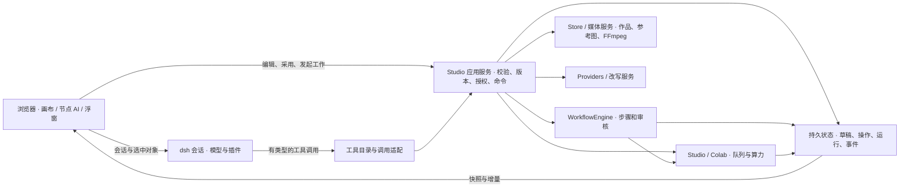

# dsh 嵌入 Studio 总体设计

**设计决定**　让浏览器和 dsh 成为同一个 Studio 创作引擎的两个客户端。**Harness 只负责界面内的创作与编排操作，运维与基础设施管理（抢/释 GPU、代理与服务商密钥、永久清理等）全部留在设置页，不进入 Harness。** 节点详情里的「AI 改写」直接调用领域服务，浮窗通过同一服务协作。服务端保管草稿、任务、会话和插件配置。dsh 专注理解意图、选择工具、组织多步创作。

本次设计基线为 2026-11-28 从远端取得的 `origin/main@61ccfcd3d1dd3c6a4fa9acc794f56cf87a1453fa`。其中包含媒体编辑 PR #5、#6 以及 PR 规范 PR #7。原型位于 `codex/workflow-harness-wip@16ae892`，两者的共同祖先是 `2189c97`。本文同时标记主干事实、分支验证和待开发契约。工具逐项评估及全路由映射放在单独目录。[主干修订](https://github.com/M1nt-Ch0c0/colab-playground/tree/61ccfcd3d1dd3c6a4fa9acc794f56cf87a1453fa) · [77 项工具目录](./tool-catalog.md) · [详细设计](./detailed-design.md)

## 一次真实的制作过程

导演选中「月面行走」这一镜，请助手保留首帧和人物，改为低机位跟拍。浮窗把选中的项目、运行、镜头和字段一起发送。助手读取这一镜的关键帧和旧词，调用 Studio 已有的 H3 改写服务，返回候选稿和使用过的参考图。导演可以直接采用，也可以先改两字。采用后，节点检查器显示同一个字段的新版本。

接着导演说“其余月面镜头也这样处理，先给我预览一镜”。助手查出匹配镜头，对它们批量提出改写，再按明确的镜头提交一次生成。GPU 队列拥有任务。关掉页面后，已经提交的任务继续执行，重开时按 ID 查回进度与结果。后台工作和跨设备草稿是目标架构。分支原型已打通读草稿、修改参数、保存后回读及多轮会话。

## 能力边界和现状

| 层 | 最新主干已有 | Harness 分支已验证 | 交付目标与缺口 |
|---|---|---|---|
| 界面 | 生图、视频、线性工作流、作品库、模型与算力设置。模板预览、笔刷、播放器选择保存在浏览器。 | 拖动/收起助手、选中节点、显示真实工具调用及参数差异。 | 按镜头显示提案、冲突、部分成功和可撤销改动。多设备共用持久草稿。 |
| 媒体与模型 | 图片导入/裁切/局部改图、MP4 导入/取帧/裁段、视频翻修/续拍/白模动作、首尾帧和逐镜上游视频。已有专业提示词改写与模型服务商选择。 | 助手能在作品库检索素材。 | 向工具提供显式资源句柄、来源角色与顺序，复用现有媒体和推理实现。 |
| 编排与执行 | 工作流定义、运行快照、七类步骤、审核暂停、继续/重试、输出编辑、持久生成队列、FFmpeg 拼接。执行按步骤顺序。 | 五个核心工具可读图、列节点、查作品、暂存编辑、请求运行。运行请求在界面落地。 | 逐镜标识、细粒度版本、幂等提交、后台采用提案及可续读事件。任意并行图另有调度要求。 |
| dsh 会话 | 主干尚无 Harness。 | 官方 Python SDK `0.2.2rc2` 和 `sdk-minimal`。同一工作流多轮使用同一个进程和 native session，实际验证有状态插件计数连续。 | 生产环境需资源可观察性、恢复策略、版本兼容及插件进程隔离。 |
| 插件 | 主干无 Studio 插件市场。 | 独立 `DSH_HOME`，本地可信的「镜头计时尺」可安装、启停、卸载并参与真实模型调用。 | 包目录、依赖检查、版本锁、更新回退、权限声明和所需宿主服务检查。带 Web/桌面界面的插件需要相应 UI 宿主。 |

主干共有 74 个 OpenAPI 路径、93 个操作，包含两个 Studio 登录操作及一个健康检查。浏览器路由、静态文件和自动 HEAD 另列。设计目录包含 77 项能力，覆盖全部操作，也包含目前仅存在于前端或尚缺底层支持的目标能力。目录中的名字不代表已经可调用。分支已注册的五个名称以及可装的第六个工具均可追溯。[主干路由入口](https://github.com/M1nt-Ch0c0/colab-playground/blob/61ccfcd3d1dd3c6a4fa9acc794f56cf87a1453fa/draw_studio/application.py) · [分支工具定义](../../draw_studio/workflows/agent_tools.py) · [覆盖表](./tool-catalog.md#主干-http-对照)

## 引擎的主路径

全量目录中，5 项是现有桥接工具，1 项是已验证的工具插件，33 项有可直接适配的主干服务，32 项需要补齐部分工程契约，6 项需要新建能力。按每行最高工程障碍评估，低难度 23 项、中等 33 项、高难度 21 项。建议先评审高难项中的三个共同依赖，即服务端草稿与逐镜版本、带冻结输入的任务幂等、插件的生命周期和信任边界。解决这三项后，多个领域可以复用同一实现。[逐项依据](./tool-catalog.md)

保留单进程 FastAPI 与数据卷单写者。HTTP 路由和 dsh 适配器调用相同的 Python 应用服务，再由现有 `WorkflowEngine`、`Studio`、`Store`、`Providers`、代理与 Colab 服务执行。绕过应用服务直接碰底层文件会遗漏锁、取消状态或快照语义。新增的操作账本与事件表可以复用 SQLite。现有运行 JSON、媒体文件及工作队列在其原有所有者下渐进迁移。[运行时生命周期](https://github.com/M1nt-Ch0c0/colab-playground/blob/61ccfcd3d1dd3c6a4fa9acc794f56cf87a1453fa/draw_studio/runtime.py) · [运行引擎](https://github.com/M1nt-Ch0c0/colab-playground/blob/61ccfcd3d1dd3c6a4fa9acc794f56cf87a1453fa/draw_studio/workflows/engine.py)

### 工具怎样进入模型

1. **启动静态注入，不做日常两跳发现。** 面向未针对本套协议特训的 DeepSeek 等通用模型，工作台在会话启动时直接把当前工作区已启用、已实现的创作工具一次性静态注册给 dsh，模型第一轮就能看到并直接调用。`studio_find_tools` 降级为可选的插件目录查询，不再作为日常调用的前置步骤。切换画布、节点或镜头时只更新本轮上下文，不重启进程，也不在会话中途改写工具表。
2. **保留 77 项能力账本，创作面静态收拢为约 26 个意图工具（零运维工具）。** 77 项目录用于追踪主干 HTTP 操作的完整归属（区分创作面与宿主运维面）；真正注册给 dsh 模型的仅覆盖界面内创作能力（工作流/节点/变量、逐镜改写与采用、素材/参考图/媒体加工、独立生成与队列控制、预设与插件），归并为约 26 个高内聚工具一次性静态注册。固定 `SYSTEM`（含高频制作套路与字段约定）、固定工具顺序和 schema 序列化，以稳定命中前缀 KV Cache。
3. **高成本动作确认执行，运维能力不入 Harness。** 抢/释 GPU、代理与服务商密钥 CRUD、Colab OAuth、永久清除等运维动作不向模型开放。涉及 GPU 生成或工作流运行的创作动作，通过操作账本冻结参数与素材快照后由用户在界面一键确认执行。
4. **本地轻量 Telemetry 与离线 Eval 闭环。** 25–30 只是起测规模，不设死红线。发版前用离线用例集在目标 DeepSeek 部署上对照评测，上线后在本地记录脱敏的工具/`op` 失败率、同轮重试修正、提案拒绝/撤销及缓存命中数，据此决定是否将高错率 `op` 拆成独立顶层工具或补充 Prompt 范例。
5. **单步按钮和 Agent 共用领域服务。** 已有图像、视频改写、本地媒体加工、H3 参考角色、队列重试均保留原调用契约。二进制内容走附件通道，工具返回资源 ID、简述、版本及必要的已授权视觉输入。

### 谁保存什么

| 数据 | 事实来源 | 断开页面后的语义 |
|---|---|---|
| 草稿、变量、节点位置、输入边、镜头及字段版本 | 目标为服务端草稿仓库。分支已保存的运行草稿在服务器，首次保存前的模板预览仍在 React。 | UI 显示保存中/已保存。已保存的状态可由 Agent 使用，未上传本地文件仍需原浏览器完成上传。 |
| 光标、缩放、当前镜头、蒙版笔触、播放头 | 当前标签页提供的选择，附项目、原件 ID 和版本。需要作为工具输入时转换为不可变句柄。 | 只沿用用户最后确认的选择。签名、版本或来源不匹配时提示重新选择。 |
| 运行、作业、上传件、作品、引用快照 | WorkflowEngine、Studio 队列和 Store。生成引用绑定到提交时的文件及顺序。 | 已提交任务由后台继续。生成状态与对话连接的生死独立。 |
| 已装插件、配置、原生会话、简短对话显示记录 | 每个 Studio 数据卷的私有 dsh 目录。原型持久化 native session，界面可回读最近 24 条成功交流。 | 刷新能接回会话。正常轮次保持插件内存。换进程时恢复历史，进程内对象由插件重建。 |
| 授权、操作账本、事件游标 | 目标为服务端持久层。主干已有单用户 Cookie 或 Bearer 登录。 | 过期授权需重新取得。多用户场景需增加 principal、workspace 与 ACL 三者的绑定。 |

## 会话和插件的产品约定

一个已保存工作流默认关联一个编排会话。未保存草稿有独立 request_id，保存后使用同一 ID 派生的 run_id。不同镜头只是同一会话的新上下文。普通发消息、收起浮窗和刷新页面都会继续使用活动实例。点停止取消当前轮，轮次结束后解除工具对编辑器的绑定。对话级停止、终止工作流和释放 GPU 分别显示各自作用对象。

`16ae892` 的池默认容纳四个会话进程。达到上限时仅回收最近最少使用的空闲会话，全部忙时返回忙碌。同一会话中同时发送两条指令会得到明确的忙碌响应。模型、有效代理或显式升级的插件配置变化会在下一轮重新装载并恢复原生记录；插件安装与卸载目标采用**版本化 profile 目录**，避免 `pnpm` 原地改写正在被其他会话使用的依赖，同时保住活跃会话的插件内存。普通空闲没有定时重启。需要承载持续监听、后台计时等插件时，下一阶段引入插件声明的后台租约、可配置进程额度和显式休眠入口，避免将 native idle 误认为插件也空闲。[会话实现](../../draw_studio/workflows/copilot.py) · [编辑器桥](../../draw_studio/workflows/agent_bridge.py)

将官方运行时作为服务器内的执行组件，浏览器绘制 Studio 浮窗。SDK 的 profile、宿主 UI 和扩展包是三个兼容维度。**`deepseek-harness-sdk` 不永久绑定 `0.2.2rc2`**：将对 dsh 内部事件、停止桥和插件 CLI 的耦合严格收口在适配层，在 `0.x` 预发布阶段以「显式锁最近测通版本 + 回归测试门禁」的方式受控跟进上游更新，待官方发布稳定版后放宽为兼容版本区间。服务端工具插件可以注册模型工具，依赖桌面侧栏、系统终端或特定 Cordis 服务的插件要先做能力协商。原生 Node 插件与 dsh 在同一进程时拥有进程级权限，面向非可信来源发布插件安装功能前，应使用独立受限进程、限定文件挂载及出站策略，并把模型凭据留在受信的调用层。[官方 SDK](https://github.com/deepseek-ai/deepseek-harness/blob/master/python/sdk/README.md) · [分支插件安装器](../../draw_studio/workflows/agent_plugins.py)

## 实施决策与验收门槛

| 阶段 | 交付物 | 最小验收与退路 |
|---|---|---|
| P0 基础与同一份草稿 | 主干对齐、会话池、静态粗粒度工具包、可配置窗口与输出预算、服务端保存、版本条件、本地轻量 Telemetry、浮窗与节点 AI 共用改写。 | 同一插件连续两轮计数递增，刷新后可继续。目标 DeepSeek 实测对照（两跳 / 平铺 / 归并）验证写回正确率与缓存命中。手改一镜与 Agent 编辑另一镜均保留，同镜输入已变时出现可操作冲突。可单独关闭 Agent 入口，手动编辑仍使用主干服务。 |
| P1 媒体与真实提交 | 逐镜 ID、引用快照、蒙版句柄、提案采用、渲染命令幂等与任务回读。 | 一次授权只创建一组 job_id。重连查回原任务。翻修、续拍、白模模式各用正确的原视频及参考图。局部改图保留选区外像素。 |
| P2 运营和插件 | 清理与释放预览、账号/密钥交接、能力授权、版本化插件目录、依赖检查、可信包回退。 | 预览集合变化拒绝批量清理。日志、Telemetry 与模型上下文不含凭据。停用或升级插件不踩坏活跃进程依赖，支持回到已知可用版本。 |
| P3 剪辑内核 | 持久时间线与依赖失效。条件分支、并行调度在有明确制作任务时单独立项。 | 单镜变化可定位受影响输出。裁段和转场的总长可用 FFprobe 对照。重复合成可追溯到相同输入修订。 |

进入实现评审前，需要产品明确三个默认值。其一是项目是否允许有配额上限的自动预览，其二是长期运行插件是否可占用保留进程，其三是可供安装的插件来源。建议先沿用当前用户点击运行、同卷独立配置和可信包目录。设计细化了每项选择的授权、资源及恢复成本。[详细设计与验证矩阵](./detailed-design.md)
